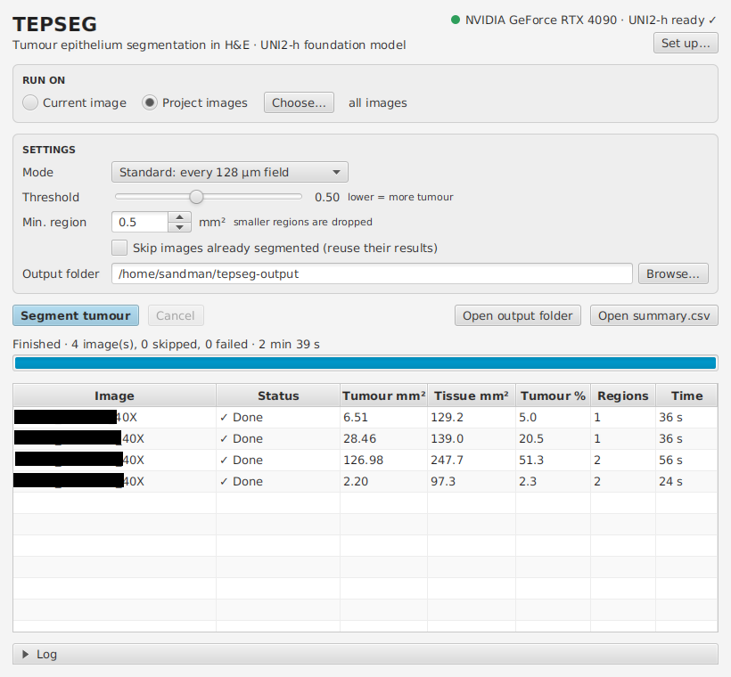

# TEPSEG-Q

**Tumour epithelium segmentation in H&E whole-slide images, in QuPath or from the command line.**

TEPSEG scores every 128 µm field of tissue with the [UNI2-h](https://huggingface.co/MahmoodLab/UNI2-h) pathology foundation model and a trained classifier head. It then traces the tumour into smooth regions. It works on one image or a whole project, on the GPU.

## QuPath



1. **Install.** Drag `qupath-extension-tepseg-<version>.jar` (from the releases page) onto QuPath 0.7 and restart.
2. **Set up once:** *Extensions › TEPSEG › Set up backend…*
   1. Click **Install**. This installs Python, PyTorch for your GPU and TEPSEG into `~/.tepseg`. Nothing else on your computer changes.
   2. **UNI2-h access:** UNI2-h is a gated model.
      1. Click **Request access…** and accept the terms on Hugging Face.
      2. Click **Create token…** and make a *Read* token.
      3. Paste the token and click **Sign in**. UNI2-h (2.7 GB) downloads once.

      If you already have UNI2-h's `pytorch_model.bin`, pick it under *Local copy* instead.
3. **Run:** *Extensions › TEPSEG › Segment tumour…*
   - **Run on:** *Current image*, or *Project images*. Use *Choose…* to pick a subset.
   - **Mode:** *Standard* scores every 128 µm field. *Fast* scores every other field and is about 4× faster, with regions within a few percent of Standard.
   - **Threshold:** the tumour probability cut-off (default 0.5; lower finds more tumour).
   - **Min. region:** smaller regions are dropped (default 0.5 mm²).
   - **Skip images already segmented:** resumes a batch by reusing earlier results.

Each image's regions are added as editable **Tumor** annotations named *TEPSEG*, as soon as the image finishes. Each annotation has `area_mm2` and `mean_probability` as measurements. Running again replaces only these annotations.

The results table shows tumour area, tissue area, tumour % and time per image. Double-click a row to open that image. *Open summary.csv* gives the batch table.

## Command line

```bash
pip install tepseg-1.0.0-py3-none-any.whl     # needs PyTorch with CUDA
tepseg login                                   # once: paste a Hugging Face token with UNI2-h access
tepseg run SLIDE_OR_FOLDER [...] -o OUT
```

| Output | Contents |
|---|---|
| `OUT/regions/<id>.geojson` | tumour regions as QuPath annotations (*File › Import objects*) |
| `OUT/masks/<id>.png` | tumour mask, 16 µm per pixel |
| `OUT/overlays/<id>.jpg` | thumbnail with the regions, for quick review |
| `OUT/slides/<id>.json` | tumour and tissue area, tumour fraction, regions, fields, time |
| `OUT/summary.csv` | one row per slide, for all slides in `OUT` |
| `OUT/tiles/<id>.csv` | tumour probability of every scored field (`--save-tiles`) |

`<id>` is the file name without its last extension. Folders are searched for `.svs`, `.ndpi`, `.tif(f)`, `.isyntax`, `.scn`, `.bif` and `.qptiff` files.

| Option | Default | |
|---|---|---|
| `--stride-um` | 128 | field spacing; 256 = fast mode |
| `--threshold` | 0.5 | tumour probability cut-off |
| `--smooth-um` | 100 | smoothing of the probability map |
| `--min-area-mm2` | 0.5 | smaller regions are dropped |
| `--min-hole-mm2` | 0.1 | smaller holes inside regions are filled; larger ones (stroma, vessels) are kept |
| `--skip-existing` | | skip slides already in `OUT` |
| `--uni2` | | a local UNI2-h `pytorch_model.bin` instead of Hugging Face |
| `--workers` | 8 | slide-reading processes |
| `--mpp` | | pixel size (µm) for slides without metadata |
| `--json` | | one JSON event per line on stdout |

Other commands:
- `tepseg info`: versions, GPU, and UNI2-h status.
- `tepseg fetch-weights`: download UNI2-h ahead of use.
- `tepseg import-weights FILE`: check a local UNI2-h copy and keep it in `~/.cache/tepseg`.

**Formats:** SVS, NDPI and generic TIFF via tiffslide, and Philips iSyntax via pyisyntax. In QuPath, any image backed by a local file in one of these formats works.

## Speed

On an RTX 4090:

| Slide | Standard | Fast |
|---|---|---|
| SVS biopsy, 139 mm² tissue (11k fields) | 36 s | 7–10 s |
| iSyntax resection, 54 mm² tissue (6k fields) | 22 s | |

UNI2-h (ViT-giant, 1.1 B parameters) runs in fp16 at about 340 fields/s and sets the pace. Worker processes read the slide in wide bands at the model's resolution while the GPU works. Tiled-JPEG SVS tiles are decoded straight at half size. Fast mode reads only the scored fields. Loading UNI2-h takes about 20 s once per run.


## License

| Part | License |
|---|---|
| QuPath extension (`qupath-extension-tepseg/`) | [Apache-2.0](qupath-extension-tepseg/LICENSE) |
| Python package (`tepseg/`) | [CC BY-NC-ND 4.0](LICENSE) |
| Classifier head (`tepseg/data/`) | [CC BY-NC 4.0](LICENSE-WEIGHTS) |

UNI2-h is not included. Each user downloads it from Hugging Face under MahmoodLab's terms (non-commercial, gated).

Contact: [sandeep.manandhar@emory.edu](mailto:sandeep.manandhar@emory.edu) · [manandhar.sandeep@gmail.com](mailto:manandhar.sandeep@gmail.com)
